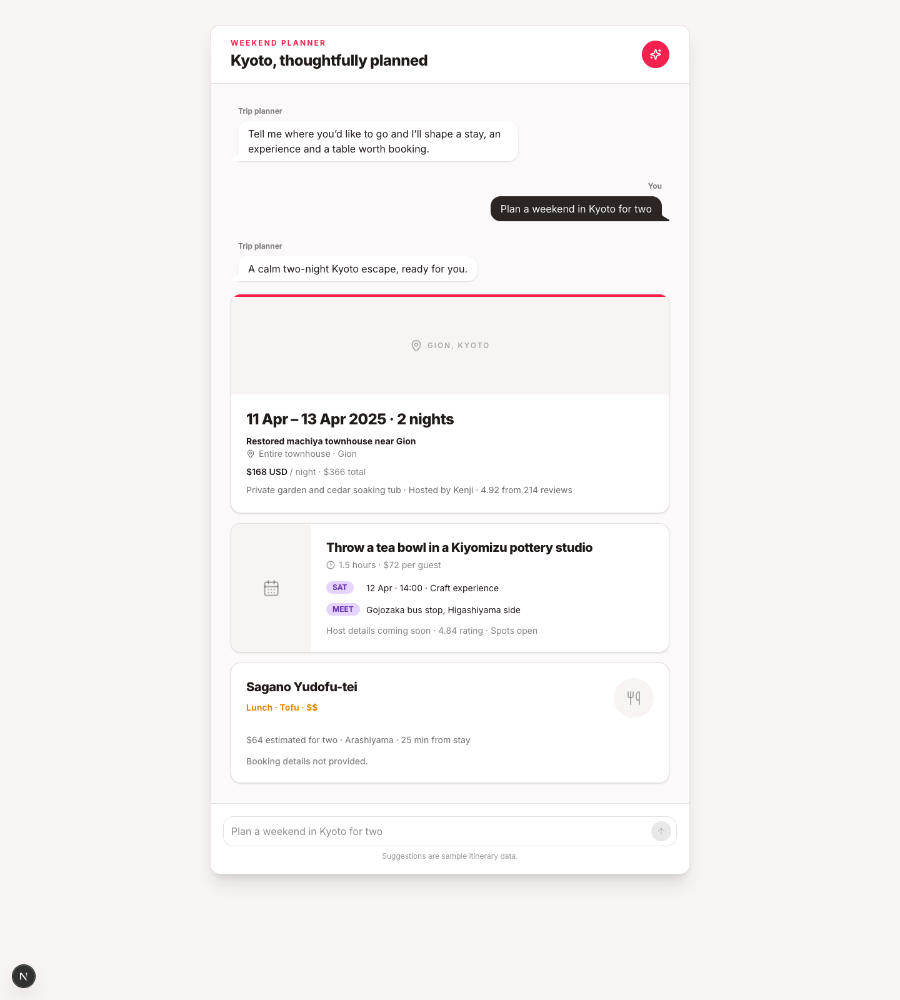
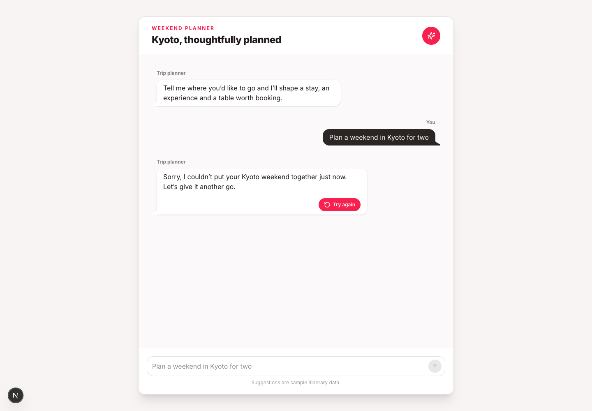

# Kyoto Weekend Planner

A responsive trip-planning chatbot built with Next.js, TypeScript, Tailwind CSS 4 and daisyUI 5. The interface turns a Kyoto weekend request into three distinct recommendation cards while exposing clear loading, success and retry states.

**Live demo:** https://susimalerdogan.github.io/zero-university-airbnb/



## Features

- Message input and send action lock while the assistant is thinking.
- Accessible thinking animation with `aria-busy` and a live status message.
- Three cards sourced from one real row per workbook sheet, in a fixed order:
  - Stay (`Stays!A3:M3`): Restored machiya townhouse near Gion
  - Experience (`Experiences!A6:L6`): Throw a tea bowl in a Kiyomizu pottery studio
  - Food (`Food!A4:I4`): Sagano Yudofu-tei
- Explicit filler copy for empty workbook fields: missing host and booking details.
- Responsive card layouts that mirror the supplied design specification.
- Forced one-time failure flow with a working retry action.
- Reduced-motion support, semantic controls and labelled icon actions.

## Run locally

```bash
npm install
npm run dev
```

Open [http://localhost:3000](http://localhost:3000), enter `Plan a weekend in Kyoto for two`, and send the message.

## Error and retry state

Trigger the public failure path at https://susimalerdogan.github.io/zero-university-airbnb/?fail=once and submit `Plan a weekend in Kyoto for two`.

The first attempt displays a friendly error bubble with a **Try again** button instead of exposing a raw error. Selecting **Try again** reruns the request and loads the three recommendation cards.



To test the same flow locally:

1. Open [http://localhost:3000/?fail=once](http://localhost:3000/?fail=once).
2. Send `Plan a weekend in Kyoto for two`.
3. Wait for the error bubble.
4. Select **Try again** to load the three cards.

## Validation

```bash
npm run build
npm run screenshot
```

The screenshot command launches the installed Google Chrome browser in headless mode and refreshes both `public/kyoto-trip-planner.png` for the successful chat state and `public/kyoto-trip-planner-error.png` for the forced failure state.

## Deployment

Every push to `main` runs `.github/workflows/deploy-pages.yml`, creates a static Next.js export and deploys the `out` directory to GitHub Pages.

## Stack

- Next.js 16 App Router
- React 19 + TypeScript
- Tailwind CSS 4
- daisyUI 5
- Lucide React icons

